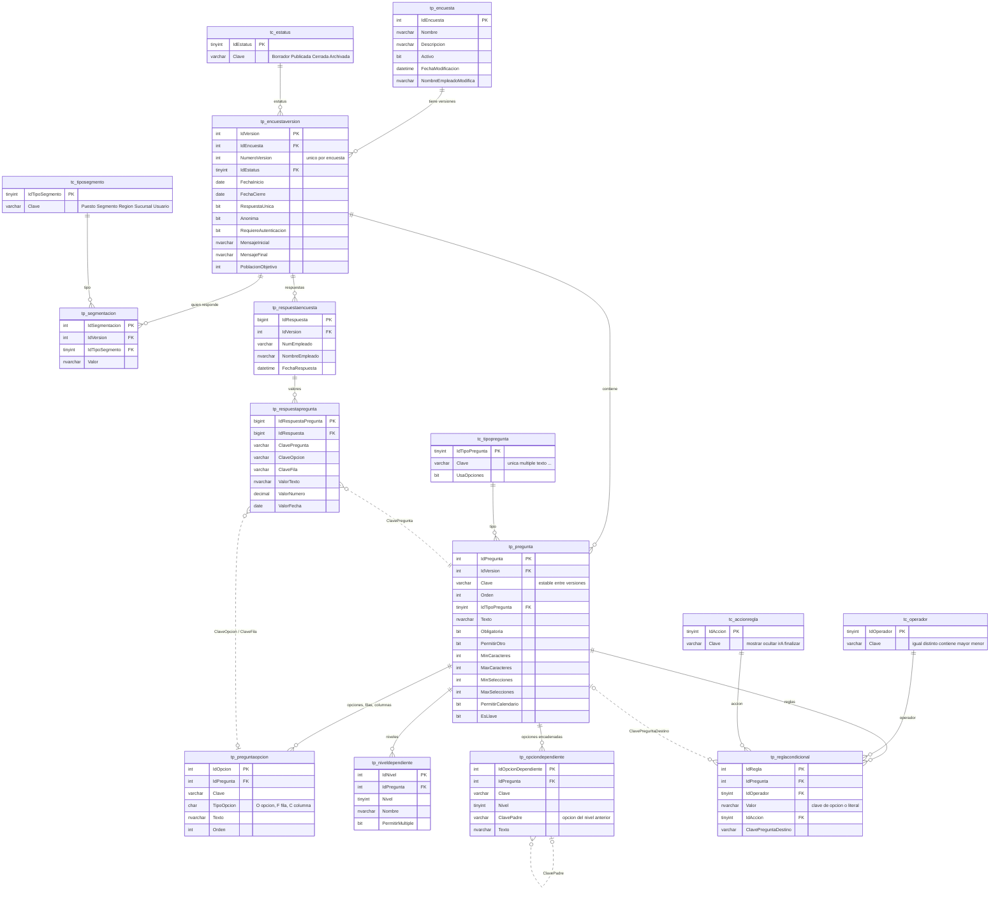

# Modelo entidad-relación — Captura Dinámica

16 tablas en el esquema `portal` con prefijo `capturadinamica_`: 6 catálogos (`tc_`) y 10 de proceso (`tp_`).
Las crea `Script_CapturaDinamica.sql`.

## Diagrama

Línea continua = llave foránea real. Línea punteada = relación lógica por `Clave` (la resuelve el código).
No se incluye `tc_menu` porque no se relaciona con otras tablas.

## Cómo funciona

### Tres bloques
- **Catálogos (`tc_`)**: valores fijos que el código conoce por su `Clave`.
- **Definición (`tp_`, versionada)**: encuesta → versiones → preguntas con opciones, niveles dependientes, reglas y segmentación.
- **Respuestas (`tp_`)**: una fila por persona en `tp_respuestaencuesta` y una fila por valor en `tp_respuestapregunta`.

### Id para la base, Clave para el negocio
Las tablas de definición tienen un `Id` numérico (llave primaria, distinto en cada versión) y una `Clave`
que **no cambia** al copiar la pregunta a una versión nueva. Reglas, opciones dependientes y respuestas
apuntan a la `Clave`. Así una versión nueva copia sus preguntas sin romper la lógica, y las respuestas
de distintas versiones se pueden comparar o recuperar con el campo llave. Por eso esas relaciones son
lógicas (punteadas) y no llaves foráneas: la `Clave` es única solo dentro de una versión.

### Versionado
1. Crear encuesta → `tp_encuesta` + versión 1 en Borrador.
2. Guardar una versión **sin respuestas** → se reemplaza su contenido (DELETE + INSERT en transacción).
3. Guardar una versión **con respuestas** → se crea la versión siguiente (o se actualiza el borrador existente); la anterior queda como histórico.
4. Publicar → la publicada anterior pasa a Archivada. El índice `UX_cd_version_publicada` permite solo una publicada por encuesta.
5. Cada respuesta queda ligada a la versión exacta que se contestó.

### Respuestas (modelo dinámico)
| Tipo | Columnas que se llenan |
|---|---|
| Opción única, Sí/No, Desplegable | `ClaveOpcion` |
| Selección múltiple, Dependiente | `ClaveOpcion` (una fila por opción elegida) |
| «Otro» | `ClaveOpcion = '__otro'` + `ValorTexto` |
| Texto libre | `ValorTexto` |
| Número, Escala | `ValorNumero` |
| Fecha | `ValorFecha` (+ `ValorTexto` con la hora si se pidió para Outlook) |
| Matriz | `ClaveFila` + `ClaveOpcion` (columna), una fila por renglón |

Las preguntas ocultas por la lógica condicional no generan filas. Un tipo de pregunta nuevo no requiere columnas nuevas.

### Lógica condicional
`tp_reglacondicional`: SI la respuesta `Operador` `Valor` ENTONCES `Accion` `ClavePreguntaDestino`.
`Valor` es la `Clave` de una opción o un valor literal. La lógica se evalúa en el navegador al capturar.

### Campo llave
La pregunta con `EsLlave = 1` permite buscar la última captura con el mismo valor en todas las versiones
de la encuesta. En resultados se cuenta solo la última captura de cada valor.
